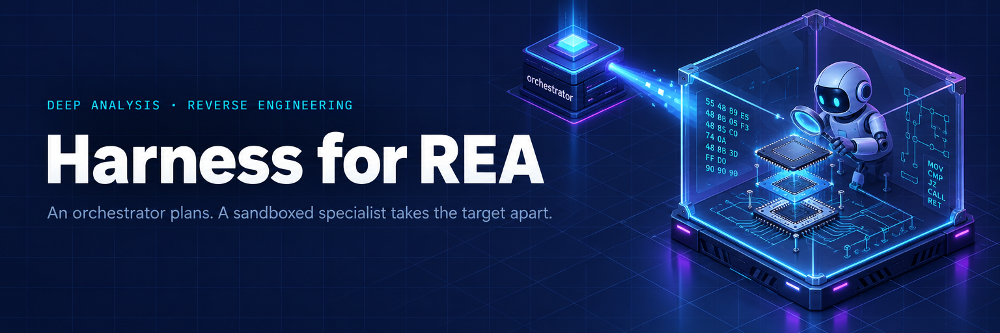
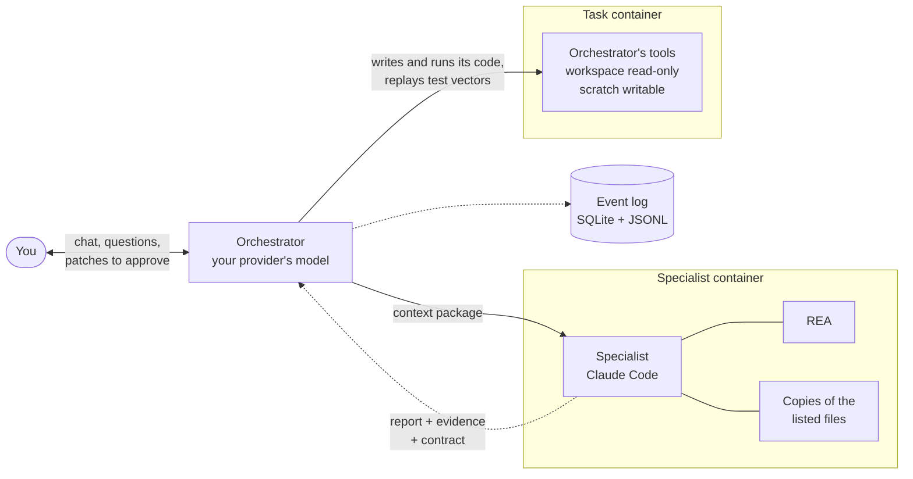
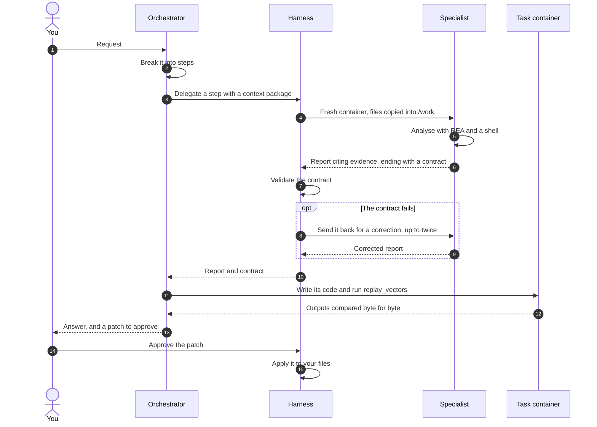
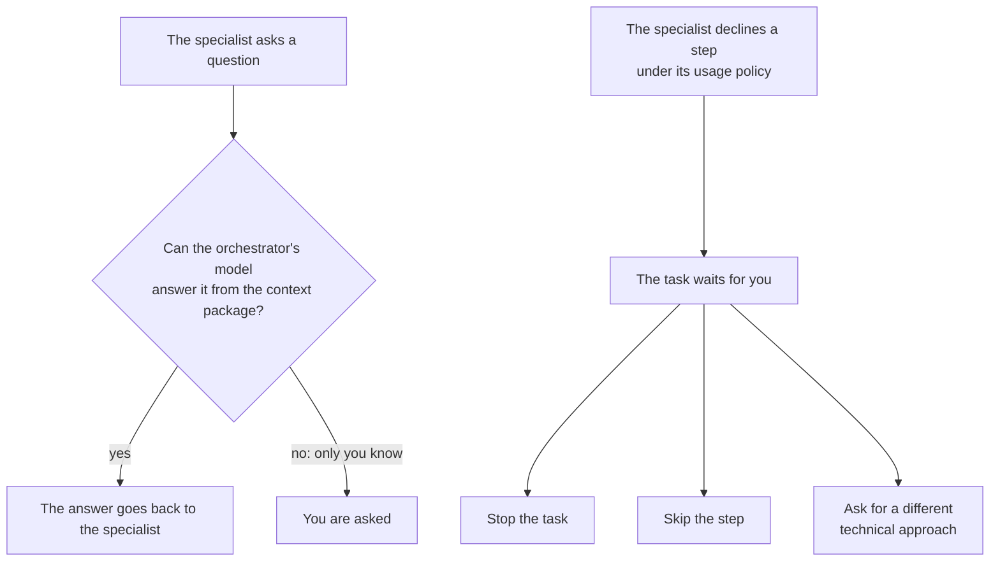
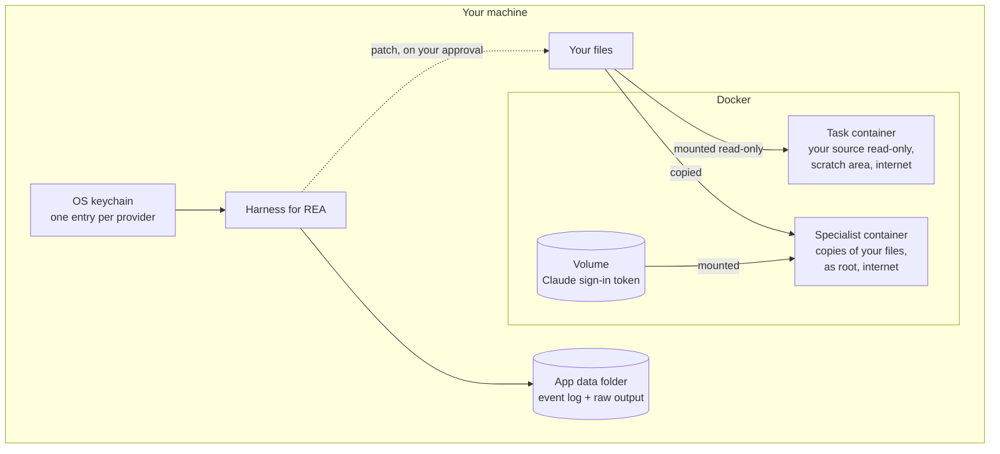
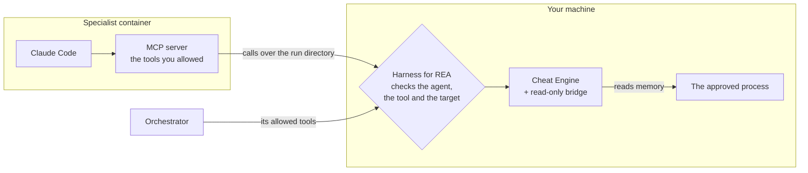
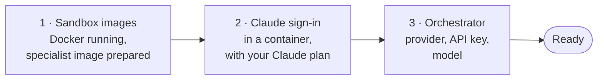
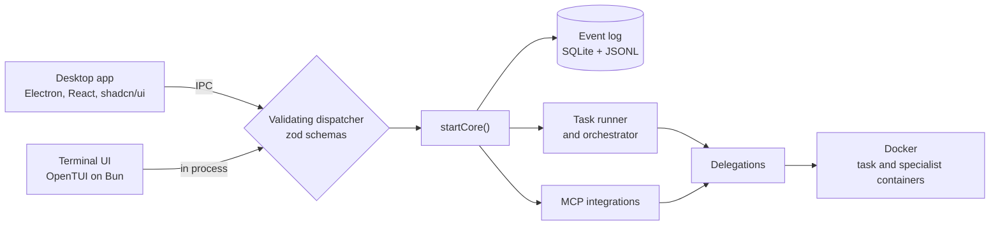
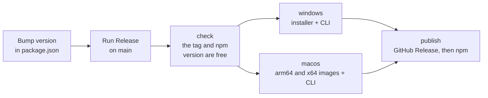

<p align="center">
  
</p>

<p align="center">
  <a href="https://github.com/protonspy/harness-for-rea/releases"></a>
  <a href="https://www.npmjs.com/package/harness-for-rea"></a>
  <a href="https://github.com/protonspy/harness-for-rea/actions/workflows/ci.yml"></a>
  
  <a href="LICENSE"></a>
</p>

<p align="center">
  <a href="#how-a-task-runs">How a task runs</a> ·
  <a href="#isolation">Isolation</a> ·
  <a href="#mcp-integrations">MCP integrations</a> ·
  <a href="#install">Install</a> ·
  <a href="#using-it">Using it</a> ·
  <a href="#development">Development</a>
</p>

# Harness for REA

A desktop app and a terminal UI for deep analysis of software you own or are authorized to study:
understanding a legacy system, debugging, reverse engineering a binary or an app, and porting or
reimplementing what it does.

You describe what you want in a chat. Two agents do the work:

| Agent                | Runs on                                                                    | Does                                                                                                                                       |
| -------------------- | -------------------------------------------------------------------------- | ------------------------------------------------------------------------------------------------------------------------------------------ |
| **The orchestrator** | a model from OpenRouter, DeepSeek or any OpenAI-compatible provider        | the agent you talk to: plans the task, prepares each step, writes and runs its own code (a decoder, a reimplementation, a probe), answers you |
| **The specialist**   | Claude Opus running the Claude Code CLI on your own Claude plan, in Docker | the deep analysis, in a container holding only the files a step needs, with [REA](https://github.com/morluto/rea) built in and a root shell |

[REA](https://github.com/morluto/rea) is a reverse engineering MCP server for native binaries,
Android, .NET, Electron and JavaScript targets. The orchestrator does not analyse the target itself.

The split keeps the expensive, careful work with the specialist and the cheap planning and coding
with the orchestrator, and keeps the target away from your machine: the specialist only ever sees
copies of the files it was handed.

## How a task runs





1. **You start a task** in a project with a request. The orchestrator breaks it into steps.
2. **For each analysis**, the orchestrator writes a _context package_: a technical brief (what the
   artifact is, what is already known), the objective, the files, the questions and the report
   format. The specialist sees that package and nothing else — not your request, not the chat.
3. **The specialist runs** in a fresh container (or a sandbox the orchestrator prepared with tools
   and files), with the files copied into `/work`. It answers with a report whose claims cite
   evidence: a line range, an address in a binary, or an REA evidence id.
4. **Every report ends with a contract**, a JSON block the app validates: the functions mapped with
   their inputs, outputs and side effects; the constants found, each with a source or marked
   estimated; the questions left open; and _test vectors_ — inputs given to the target and the
   output it produced, observed by running it. A report whose contract fails is sent back to the
   specialist for a correction, up to twice.
5. **The orchestrator writes its code** from the report and checks it with `replay_vectors`, which
   runs the vectors against its reimplementation and compares outputs byte for byte.
6. **Changes to your files** come back as patches. Nothing outside the task's containers changes
   until a patch is applied.

### Questions and refusals



**Questions.** Either agent can ask you a question mid-run. The specialist's questions go first to
the orchestrator's model, which answers from the context package when it can; questions about
authorization, ownership or purpose always come to you.

**Refusals.** If the specialist declines a step under its usage policy, the task waits for you to
stop it, skip the step, or ask for a different technical approach. The request is never reworded to
get past the refusal.

**Projects.** A project is one target — a file (an APK, an executable, an archive) or a folder —
with a goal and the model its tasks use. Tasks in a project share its sandboxes and everything
earlier tasks found, and the questions one analysis left open are handed to the next.

## Isolation



- The specialist runs in a container per delegation, or in a sandbox the orchestrator created for
  the project; of your files it sees only the copies made for it, as root, with internet access.
  Its Claude Code runs with no user or project settings, so a `CLAUDE.md` or settings left in
  `/work` by an earlier step are never loaded.
- The orchestrator's tools run in a task container, as root with internet access, where your
  source is mounted read-only; they write to your machine only through its scratch area.
- The specialist signs in with your Claude plan once; the token lives in a Docker volume mounted
  into the specialist's container.

> [!WARNING]
> The container keeps a target away from your machine, not from your Claude account. The specialist
> has a root shell and internet access beside the sign-in token, so a hostile target that steers it
> can read the token and send it out. Do not analyse an untrusted sample with an account you cannot
> afford to expose.
- Provider API keys are kept in the OS keychain, in one entry per provider both apps read, and
  redacted from everything the app records or sends to a model.
- Everything the agents do is recorded per task: an event log in SQLite and each agent's raw output
  as JSONL, in the app's data folder.

## MCP integrations

Engines that run on your machine reach the agents only through the app. **Cheat Engine** is the
first: the agents read the live memory of a Windows process you approved, through a bridge the app
ships and that answers read-only commands only.



- **Settings → MCP integrations** lists the integrations the app carries, each off by default. Turning one on
  runs its checks — for Cheat Engine: the executable exists, the bridge script is installed in its
  `autorun` folder, and the bridge answers with the version the app carries — and a failed check
  says what fixes it.
- **Each integration has its own page**, with one toggle per tool for the orchestrator and one for
  the specialist. The specialist starts with every tool; the orchestrator starts with `status` and
  `get_process_list` only, and turning on a tool that reads a target warns that what it returns
  goes to the orchestrator's provider.
- **Every target is approved by you**, shown by its name, PID and executable path, even in an
  automatic task. A delegation with an approved process cannot reach any other. What the tools
  read from it — secrets included — goes to the agents' models and their reports, and the
  specialist's container has full internet access.
- **The bridge only reads**: the process list, modules, memory regions, memory, value and byte
  scans, pointer chains, disassembly, symbols and structures. Writing memory, injecting code and
  debugging are not there to call. Its pipe takes any local client, so while Cheat Engine runs
  with the bridge, the app's checks bind the agents but not other programs on your machine.
- **The container gets nothing new**: no mount, port or environment variable. Each call is
  recorded in the task's event log with its agent, tool, target and outcome, never its answer.

Integrations are set up in the desktop app; the terminal UI uses them as Settings has them.

## What you need

- **Docker** (Docker Desktop on Windows and macOS), running. At the first start the app pulls the
  specialist's base image from GHCR and builds the specialist image on it.
- **A Claude plan** (Pro or Max) for the specialist.
- **An API key** for the orchestrator's provider: OpenRouter by default, DeepSeek, or any
  OpenAI-compatible endpoint.
- **Cheat Engine** on Windows, only for its integration.

## Install

Download the build for your system from the
[releases](https://github.com/protonspy/harness-for-rea/releases):

| System                      | Desktop app                                       | Terminal UI                                        |
| --------------------------- | ------------------------------------------------- | -------------------------------------------------- |
| Windows x64                 | `harness-for-rea-<version>-windows-x64-setup.exe` | `harness-for-rea-cli-<version>-windows-x64.zip`    |
| macOS arm64 (Apple silicon) | `harness-for-rea-<version>-macos-arm64.dmg`       | `harness-for-rea-cli-<version>-macos-arm64.tar.gz` |
| macOS x64 (Intel)           | `harness-for-rea-<version>-macos-x64.dmg`         | `harness-for-rea-cli-<version>-macos-x64.tar.gz`   |

Nothing is signed or notarized, so each system asks once:

- **Windows** — SmartScreen may stop the setup: choose **More info**, then **Run anyway**.
- **macOS, the desktop app** — drag it from the disk image to Applications, then, before the first
  launch, run:

  ```bash
  xattr -dr com.apple.quarantine "/Applications/Harness for REA.app"
  ```

- **macOS, the terminal UI** — unpack the archive, then run in its folder:

  ```bash
  xattr -dr com.apple.quarantine ./harness-for-rea
  ./harness-for-rea
  ```

  Keep the `sandbox/` folder next to the binary: it holds the specialist image's sources and the
  MCP integrations' files.

The terminal UI is also on npm, for Windows and macOS:

```bash
npm install -g harness-for-rea
cd path/to/what/you/analyse
harness-for-rea
```

## First run



Both apps open on a setup of three steps, and nothing else opens until all three are ready:

1. **Sandbox images** — Docker running and the specialist image prepared.
2. **Claude sign-in** — runs in a container: open the link it shows, sign in with your Claude plan,
   and paste the code back.
3. **Orchestrator** — the provider, its API key and the model.

In the terminal UI the setup opens inline and each step is a command: `/images` prepares the
images again, `/login` opens the sign-in in your browser and `/code <code>` sends the code back,
`/provider`, `/base-url <url>`, `/key <key>` and `/model` (a list to pick from) set the
orchestrator, and `/done` finishes once every step is ready. A step readied in either app is ready
in the other.

## Using it

**Desktop app.** Create a project from a target and a goal, then start tasks in it. A task shows as
a chat: the messages, each tool call, and each delegation as a card with the specialist's own steps
inside it. Long tasks load their history in pages as you scroll up. The side panel has the plan,
the delegations with their reports and evidence, the cost per agent, and the raw event log. The
project page lists its tasks, what the specialist found, and the questions still open. Settings is
split into tabs: Orchestrator model, Sandbox, Specialist, MCP integrations and You in the loop.

**Terminal UI.** Run `harness-for-rea` in the folder you want to analyse, or give its path:
`harness-for-rea C:\samples\app`. The folder is the target of the project it opens — the one
project on it, a choice when there are several, or a new one prefilled with the folder's name, its
detected kind and your Settings model. A home folder, a drive, a Downloads folder or one holding the
app's data asks you to type its path before it is mounted; the app's data folder itself is refused.
`--continue` reopens the folder's last task and `--resume` lists its tasks.

A task is a conversation: the agent's messages as markdown with colored code, each tool call on one
line with its arguments and output under it, each delegation with its context package, report,
evidence, files and the specialist's own steps, and a working line with the elapsed time, tokens and
cost. Questions and gated tool calls open as dialogs; a proposed patch shows as a diff. The sidebar
has the plan, the delegations, the cost per agent and the files touched.

| Key    | Does                                                               |
| ------ | ------------------------------------------------------------------ |
| Enter  | send the message; Shift+Enter or Ctrl+J starts a new line          |
| ↑ ↓    | the messages sent this session, at the prompt's first and last line |
| `/`    | the screen's commands, completed with Tab                          |
| `@`    | a path from the project's folder, completed with Tab               |
| Ctrl+P | every command, searchable                                          |
| Tab    | move between the prompt and the transcript or list                 |
| Ctrl+O | expand or collapse every tool call and delegation                  |
| Ctrl+B | show or hide the sidebar                                           |
| Esc    | stop the running turn, close a dialog, or go back                  |
| Ctrl+C | clear the prompt; twice to quit                                    |
| `?`    | every key on the screen                                            |

Commands on a task: `/stop`, `/continue`, `/close`, `/cancel`, `/start-over`, `/delete`, `/answer`,
`/decide`, `/approve-patch`, `/reject-patch`, `/events` (the event log, filtered by agent) and
`/older`. Everywhere: `/projects`, `/tasks`, `/new`, `/settings`, `/setup`, `/sidebar`, `/quit`.
`--theme light` (or `HFR_THEME=light`) switches to the light colors.

**Side by side.** Any number of terminal UIs, each in its own folder, run beside the desktop app on
the same data folder. A project runs its tasks in one app at a time: while one app runs a task of
it, the others show it as taken and can read its tasks but not start one there. An app that stops
leaves the others' tasks alone; the next app to start recovers what it was running. A key saved in
one app is used by the others. `harness-for-rea --version` and `--help` work at any time.

## How the code is organized



```
src/main/            the core (Node): Electron shell and everything behind it
  core.ts            wires the database, event log, projects, sandboxes, runner and API handlers
  index.ts           the Electron shell: window, IPC, dialogs
  orchestrator/      the orchestrator agent, its tools, the task runner, the model
  delegation.ts      one delegation: workspace, specialist run, contract check, patch
  specialist/        running Claude Code and reading its stream-json output
  sandbox/           Docker: images, containers, sandboxes, prompts, patches
  integrations/      the MCP integrations: registry, tool gate, target approval, settings
  cheatengine/       Cheat Engine's integration and the pipe to its bridge
  events/            the event log (SQLite + JSONL) and redaction
  unknowns.ts        the per-project ledger of open questions
src/shared/          types and the IPC contract (zod schemas) shared with the views
src/renderer/        the desktop UI (React, Tailwind, shadcn/ui on Radix)
tui/                 the terminal UI (OpenTUI's React layer on Bun) and its npm package
sandbox/             the specialist's images, the integrations' MCP server and Cheat Engine's bridge
scripts/             test gate, image pinning, CLI build
tests/               Vitest suite; the specialist is faked by tests/fixtures/fake-claude.mjs
```

The desktop app and the terminal UI run the same core: `startCore()` takes the data folder, how to
deliver updates to the view, and where keys are kept, and returns the API handlers. Every call from
either UI goes through the same validating dispatcher.

## Development

Node 24 and npm; Docker for the sandboxes; Bun 1.4 for the terminal UI.

```bash
# Install (npm 11 skips install scripts; the Electron binary is fetched by its own script)
npm install
node node_modules/electron/install.js

# Typecheck, then build main, preload and renderer into out/
npm run typecheck && npm run build

# Run the desktop app in development
npm run dev

# Run the terminal UI from source
npm run tui

# Tests: the suite, one file, and the coverage report the CI gate reads
npm test
npx vitest run tests/orchestrator.test.ts
node scripts/test-gate.mjs

# Tests against the real Docker and your Claude login, and against Bun: the core under Bun, and the
# terminal UI's screen tests on OpenTUI's test renderer; the gate counts both with HFR_BUN=1, as CI does
HFR_DOCKER=1 npx vitest run tests/claude-md.test.ts
HFR_BUN=1 npx vitest run tests/bun-core.test.ts
bun test tui/test

# Lint and format
npm run lint
npm run format:check

# Package: Windows installer, macOS disk images, the CLI's npm package and a standalone binary
npm run dist
npm run dist:mac
bun scripts/build-cli.ts package
bun scripts/build-cli.ts binary bun-windows-x64 cli
```

Tests run the TypeScript sources directly. The specialist is `tests/fixtures/fake-claude.mjs`, which
speaks Claude Code's stream-json; the orchestrator's provider is a scripted `fetch`.

### Releasing



To release, bump `version` in `package.json` and run the **Release** workflow on `main`. It builds
everything above for Windows and macOS, publishes a GitHub Release, and publishes the CLI to npm
with the `NPM_TOKEN` repository secret.

### Hopper request attribution

When an OpenAI-compatible provider uses `https://api.withhopper.com/v1`, the
app identifies itself with `X-Hopper-Client: harness-for-rea` on model-list,
connection-test and orchestrator requests, including streams. The header contains
only the app name; it adds no user, project or machine identifiers. Other
provider origins receive no Hopper attribution header. Any partner pricing is
controlled by Hopper; this header does not grant access or guarantee a discount.

## License

[MIT](LICENSE).
