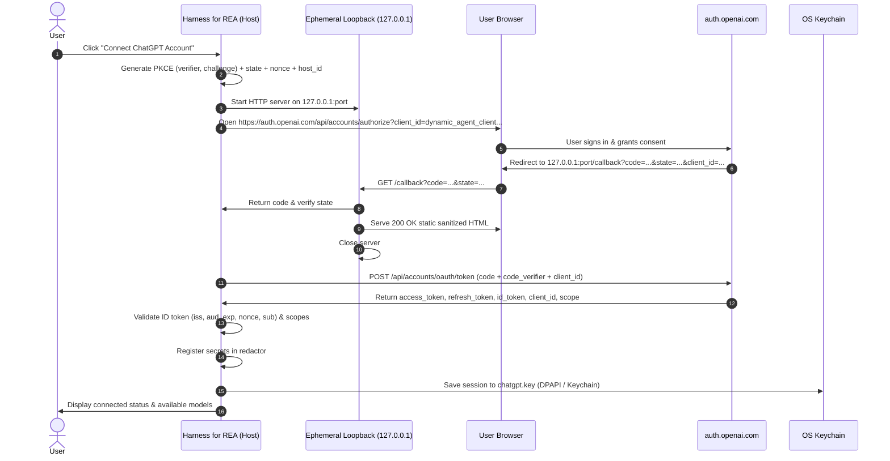
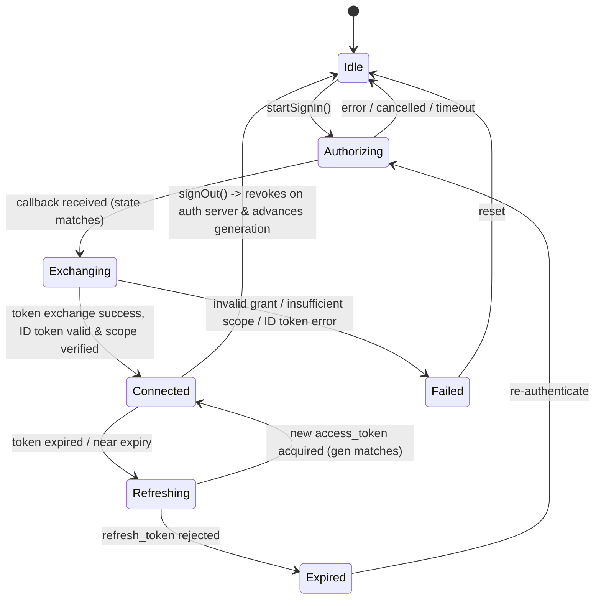

# ChatGPT / Codex OAuth provider with token sharing — design

## Overview

The ChatGPT provider enables users with ChatGPT Plus or Pro accounts to authenticate using OpenAI's official open-source token-sharing standard (ADR 0030) and run tasks using their subscription model allowance without a commercial API key.

## Architecture

## State Machine & Generational Coordination

## Component Boundaries

1. `src/main/chatgpt.ts`: Implements `ChatGPTAuthService`, PKCE helpers, loopback server lifecycle, token exchange, token refresh with generational coordination, ID token validation, and scope verification.
2. `src/shared/providers.ts`: Adds `chatgpt` to `PROVIDER_IDS` with preset configuration (`gpt-4o`, `gpt-4o-mini`, `o1`, `o3-mini`).
3. `src/shared/api.ts` & `src/main/core.ts`: Wires IPC bridge methods (`startChatGPTAuth`, `chatGPTAuthStatus`, `cancelChatGPTAuth`, `chatGPTLogout`) to the `ChatGPTAuthService` instance in host.
4. `src/main/credentials.ts`: Recognizes `chatgpt` provider key slot `chatgpt.key`.
5. `src/main/orchestrator/model.ts` & `models.ts`: Dispatches `chatgpt` requests to OpenAI Responses API with authorized bearer token.
6. `src/renderer/src/components/setup/panels.tsx`: UI component `ChatGPTOAuthBox` offering seamless one-click connect and disconnect actions.
