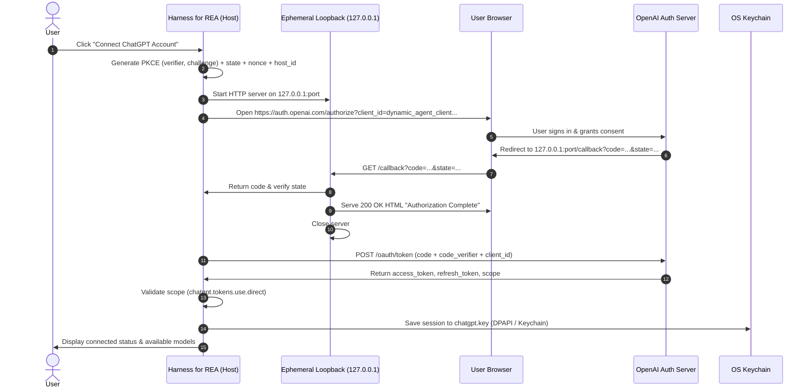
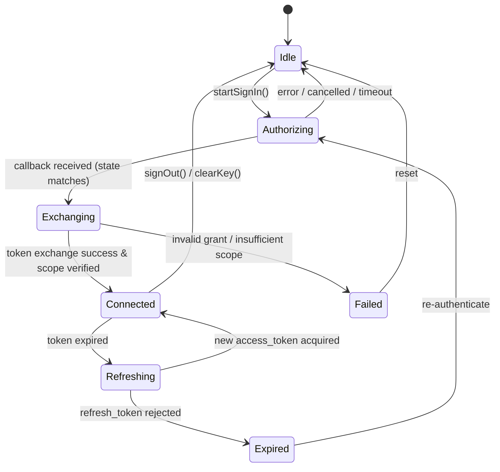

# ChatGPT / Codex OAuth provider with token sharing — design

## Overview

The ChatGPT provider enables users with ChatGPT Plus or Pro accounts to authenticate using OpenAI's official open-source token-sharing standard (ADR 0030) and run tasks using their subscription model allowance without a commercial API key.

## Architecture

## State Machine

## Component Boundaries

1. `src/main/chatgpt.ts`: Implements `ChatGPTAuthService`, PKCE helpers, loopback server lifecycle, token exchange, token refresh, and scope validation.
2. `src/shared/providers.ts`: Adds `chatgpt` to `PROVIDER_IDS` with preset configuration (`gpt-4o`, `gpt-4o-mini`, `o1`, `o3-mini`).
3. `src/main/credentials.ts`: Recognizes `chatgpt` provider key slot `chatgpt.key`.
4. `src/main/orchestrator/model.ts`: Dispatches `chatgpt` requests to OpenAI API with authorized bearer token.
